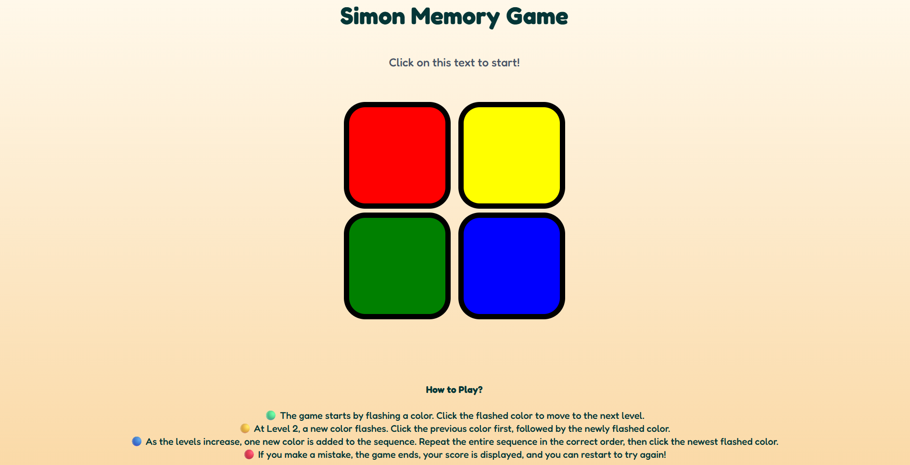

# Simon Memory Game

A simple browser-based Simon Says memory game. Watch the color sequence grow one step at a time, then repeat it in the correct order. How far can you get?

## Screenshot

## Features

- Four interactive color buttons: red, green, yellow, and blue
- A randomly generated sequence that grows by one color each level
- Visual feedback for the game's sequence and your clicks
- Game-over screen with your score and highest score for the current page session
- Responsive, bright interface with a Google Font
- No build tools or package installation required

## How to Play

1. Open the game and click **“Click on this text to start!”**.
2. Watch the color that flashes.
3. Click the colors in the same order. Each new level adds one color to the sequence, and you must repeat the full sequence from the beginning.
4. A wrong click ends the game. Your score is based on the number of completed levels (10 points per level).
5. To start another game after a loss, reload the page.

## Run Locally

1. Download or clone this repository.
2. Open `index.html` in a modern web browser.

There is no server setup or build step. An internet connection is only needed to load the Fredoka font from Google Fonts; the game itself runs locally in the browser.

## Project Structure

- `index.html` — Game page structure and instructions
- `style.css` — Layout, colors, and button animations
- `script.js` — Sequence generation, input checking, scoring, and game state

## Built With

- HTML
- CSS
- Vanilla JavaScript
- [Google Fonts: Fredoka](https://fonts.google.com/specimen/Fredoka)
